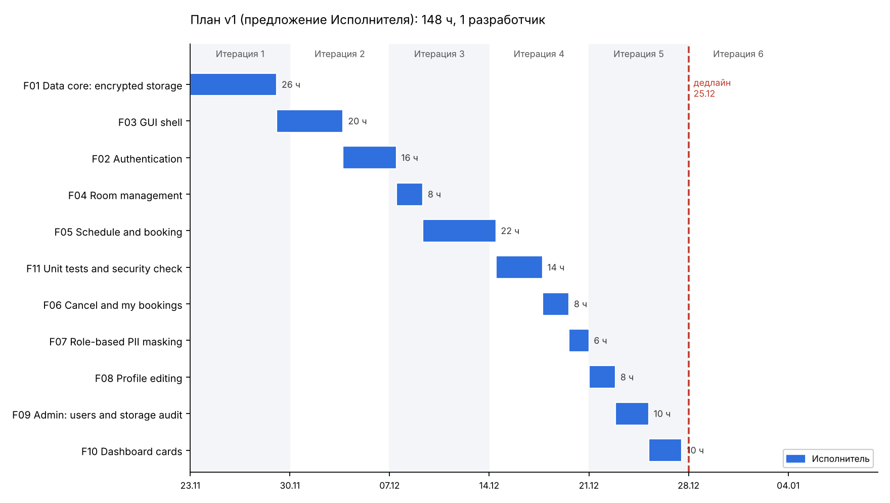
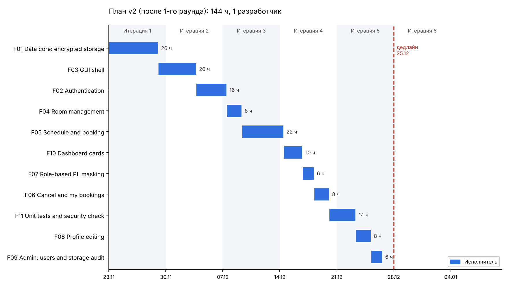
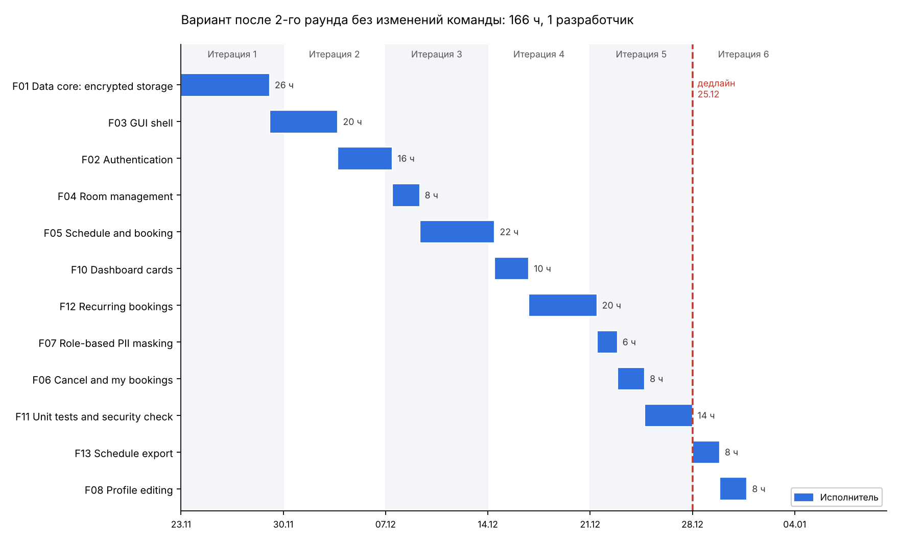
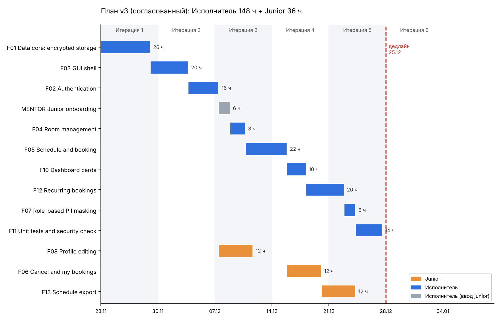

# План реализации SecureBooking

Версия 3 (согласована с заказчиком 20.11.2026). Документ дополняет [`sdd.md`](sdd.md) (приложение Б).

Цифры и диаграммы рассчитываются скриптом [`tools/plan.py`](tools/plan.py) — при изменении оценок план пересчитывается одной командой: `python docs/tools/plan.py docs/images`.

## 1. Исходные данные

| Параметр | Значение |
|----------|----------|
| Начало работ | 23.11.2026 (понедельник) |
| Длина итерации | 1 неделя (5 рабочих дней) |
| Дата выпуска (дедлайн заказчика) | 25.12.2026 — конец итерации 5 |
| Ёмкость Исполнителя | 30 ч в неделю, 150 ч до дедлайна |
| Ставка Исполнителя | 25 у.е./ч |
| Junior-разработчик (план v3) | 20 ч в неделю с итерации 3, 10 у.е./ч, оценки задач ×1.5 |
| Ввод junior в проект | 6 ч Исполнителя |

| Итерация | Даты |
|----------|------|
| I1 | 23.11 – 27.11 |
| I2 | 30.11 – 04.12 |
| I3 | 07.12 – 11.12 |
| I4 | 14.12 – 18.12 |
| I5 | 21.12 – 25.12 |
| I6 | 28.12 – 01.01 |

## 2. Функции, оценки и приоритеты

Приоритет: 10 — Critical, 20 — High, 30 — Medium, 40 — Low, 50 — Optional.

| ID | Feature (EN) | Функция | Оценка, ч | Зависит от | Приоритет v1 | v2 | v3 |
|----|--------------|---------|-----------|------------|--------------|----|----|
| F01 | Data core: encrypted storage | Ядро данных: шифрование ПД, ключи DPAPI, HMAC файла | 26 | — | 10 | 10 | 10 |
| F02 | Authentication | Регистрация и вход, PBKDF2, блокировка перебора | 16 | F01 | 10 | 10 | 10 |
| F03 | GUI shell | Каркас интерфейса WinAPI: окна, меню, формы | 20 | — | 10 | 10 | 10 |
| F04 | Room management | Управление переговорными (администратор) | 8 | F01, F03 | 20 | 20 | 20 |
| F05 | Schedule and booking | Расписание и бронирование с проверкой пересечений | 22 | F02, F04 | 10 | 10 | 10 |
| F06 | Cancel and my bookings | Отмена и список «Мои бронирования» | 8 | F05 | 20 | 20 | 20 |
| F07 | Role-based PII masking | Маскирование чужих ПД по ролям | 6 | F05 | 20 | 20 | 20 |
| F08 | Profile editing | Изменение своих ПД и пароля | 8 | F02 | 30 | 40 | 40 |
| F09 | Admin: users and storage audit | Администрирование: пользователи и аудит хранилища | 10 (v2: 6) | F02 | 40 | 50 | исключена |
| F10 | Dashboard cards | Карточки главного окна (показатели, переговорные) | 10 | F05 | 40 | 20 | 20 |
| F11 | Unit tests and security check | Модульные тесты и проверка безопасности | 14 | F01, F02, F05 | 20 | 20 | 20 |
| F12 | Recurring bookings | Повторяющиеся (еженедельные) бронирования | 20 | F05 | — | — | 20 |
| F13 | Schedule export | Экспорт расписания в CSV и печать | 8 | F05 | — | — | 30 |

## 3. План v1 — предложение Исполнителя (16.11)

Объём 148 ч при ёмкости 150 ч, выпуск 25.12, стоимость **3700 у.е.**

| Функция | Приоритет | Оценка, ч | Итерации |
|---------|-----------|-----------|----------|
| F01 Data core: encrypted storage | 10 | 26 | I1 |
| F03 GUI shell | 10 | 20 | I1–I2 |
| F02 Authentication | 10 | 16 | I2–I3 |
| F04 Room management | 20 | 8 | I3 |
| F05 Schedule and booking | 10 | 22 | I3–I4 |
| F11 Unit tests and security check | 20 | 14 | I4 |
| F06 Cancel and my bookings | 20 | 8 | I4 |
| F07 Role-based PII masking | 20 | 6 | I4 |
| F08 Profile editing | 30 | 8 | I5 |
| F09 Admin: users and storage audit | 40 | 10 | I5 |
| F10 Dashboard cards | 40 | 10 | I5 |

## 4. План v2 — после 1-го раунда (18.11)

Изменения: заказчик поднял приоритет карточек главного окна (F10: 40 → 20), понизил профиль (F08: 30 → 40) и аудит хранилища (F09: 40 → 50). Исполнитель упростил аудит до просмотра файла без поиска и подсветки (F09: 10 → 6 ч).

Объём 144 ч, выпуск 25.12, стоимость **3600 у.е.**

| Функция | Приоритет | Оценка, ч | Итерации |
|---------|-----------|-----------|----------|
| F01 Data core: encrypted storage | 10 | 26 | I1 |
| F03 GUI shell | 10 | 20 | I1–I2 |
| F02 Authentication | 10 | 16 | I2–I3 |
| F04 Room management | 20 | 8 | I3 |
| F05 Schedule and booking | 10 | 22 | I3–I4 |
| F10 Dashboard cards | 20 | 10 | I4 |
| F07 Role-based PII masking | 20 | 6 | I4 |
| F06 Cancel and my bookings | 20 | 8 | I4 |
| F11 Unit tests and security check | 20 | 14 | I4–I5 |
| F08 Profile editing | 40 | 8 | I5 |
| F09 Admin: users and storage audit | 50 | 6 | I5 |

## 5. 2-й раунд (19–20.11): изменение объёма

- исключена F09 (список пользователей и аудит хранилища перенесены в версию 1.1): −6 ч;
- добавлена F12 «Повторяющиеся бронирования» (20 ч, приоритет 20): модель серии — 4 ч, проверка всех дат и конфликтов — 6 ч, окно выбора повторения — 5 ч, отмена серии — 2 ч, тесты — 3 ч;
- добавлена F13 «Экспорт расписания» (8 ч, приоритет 30): выгрузка CSV — 3 ч, печать — 3 ч, пункт меню и диалог — 2 ч.

Новый объём **166 ч** — на 16 ч больше ёмкости одного разработчика до дедлайна. Вариант Исполнителя «сдвинуть выпуск» — релиз 01.01.2027 (итерация 6), стоимость 4150 у.е. — **отклонён заказчиком**: дата 25.12 жёсткая, значительное удорожание недопустимо.

## 6. План v3 — согласованный (20.11): + junior-разработчик

С итерации 3 в проект входит junior-разработчик (20 ч/нед). Ему переданы слабо связанные задачи слоя интерфейса: F08, F06, F13 (оценки ×1.5). Исполнитель тратит 6 ч на ввод junior в проект и проверяет его код.

| Функция | Приоритет | Оценка, ч | Итерации | Исполнитель |
|---------|-----------|-----------|----------|-------------|
| F01 Data core: encrypted storage | 10 | 26 | I1 | Исполнитель |
| F03 GUI shell | 10 | 20 | I1–I2 | Исполнитель |
| F02 Authentication | 10 | 16 | I2–I3 | Исполнитель |
| MENTOR Junior onboarding | 10 | 6 | I3 | Исполнитель |
| F04 Room management | 20 | 8 | I3 | Исполнитель |
| F05 Schedule and booking | 10 | 22 | I3–I4 | Исполнитель |
| F10 Dashboard cards | 20 | 10 | I4 | Исполнитель |
| F12 Recurring bookings | 20 | 20 | I4–I5 | Исполнитель |
| F07 Role-based PII masking | 20 | 6 | I5 | Исполнитель |
| F11 Unit tests and security check | 20 | 14 | I5 | Исполнитель |
| F08 Profile editing | 40 | 12 | I3 | Junior |
| F06 Cancel and my bookings | 20 | 12 | I4 | Junior |
| F13 Schedule export | 30 | 12 | I4–I5 | Junior |

## 7. Сравнение вариантов

| Вариант | Объём | Команда | Выпуск | Стоимость, у.е. | Решение заказчика |
|---------|-------|---------|--------|-----------------|-------------------|
| v1 | 148 ч | Исполнитель | 25.12.2026 | 3700 | заменён v2 |
| v2 | 144 ч | Исполнитель | 25.12.2026 | 3600 | заменён после 2-го раунда |
| 2-й раунд, сдвиг срока | 166 ч | Исполнитель | 01.01.2027 | 4150 | отклонён |
| **v3** | 148 + 36 ч | Исполнитель + Junior | **25.12.2026** | **4060** (3700 + 360) | **согласован** |

Удорожание v3 относительно v2 — 460 у.е. (12.8 %) за две новые функции; это на 90 у.е. дешевле варианта со сдвигом срока, и выпуск остаётся 25.12.2026.

## 8. Риски плана v3

| Риск | Мера |
|------|------|
| Junior не укладывается в оценки | Оценки уже увеличены в 1,5 раза; задачи junior имеют приоритет 20–40 и при необходимости переносятся в версию 1.1 |
| Простой junior в итерации 3 (ждёт F05) | Помогает писать тесты F11 и проверяет прототипы окон |
| Ошибки в криптографическом ядре | F01 выполняет только Исполнитель; эталонные тесты RFC (F11) |
| Новые изменения требований | Изменения принимаются через pull request; оценка и перепланирование до начала следующей итерации |
