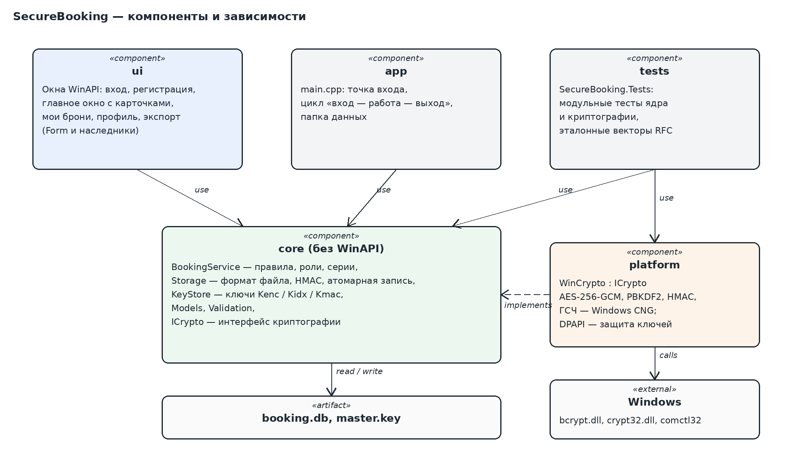
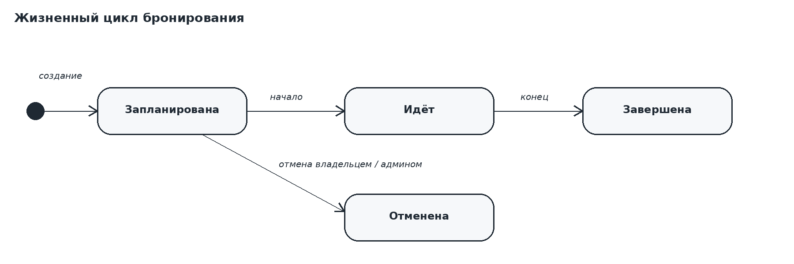

# Описание дизайна программного обеспечения

Для SecureBooking — защищённой системы бронирования переговорных

Версия 1.0

Подготовил Аксак В. С., гр. 434701

БГУИР, кафедра ЭВМ

2026-11-20

## Оглавление

<!-- TOC -->
* [1. Введение](#1-introduction)
  * [1.1 Назначение документа](#11-document-purpose)
  * [1.2 Область применения](#12-subject-scope)
  * [1.3 Определения, акронимы и сокращения](#13-definitions-acronyms-and-abbreviations)
  * [1.4 Ссылки](#14-references)
  * [1.5 Обзор документа](#15-document-overview)
* [2. Обзор дизайна](#2-design-overview)
  * [2.1 Задачи стейкхолдеров](#21-stakeholder-concerns)
  * [2.2 Выбранные точки зрения](#22-selected-viewpoints)
* [3. Проектные представления](#3-design-views)
* [4. Решения](#4-decisions)
* [5. Приложения](#5-appendixes)
  * [Приложение А. Системные требования и приоритеты](#appendix-a)
  * [Приложение Б. Функции, оценки и план реализации](#appendix-b)
<!-- TOC -->

## История изменений

| Name | Date | Reason For Changes | Version |
|------|------|--------------------|---------|
| Аксак В. С. | 2026-11-16 | Первая редакция: архитектура, системные требования, оценки (план v1) | 0.1 |
| Аксак В. С. | 2026-11-18 | 1-й раунд с заказчиком: изменены приоритеты SYS-12, SYS-14, SYS-20, упрощён аудит хранилища (план v2) | 0.2 |
| Аксак В. С. | 2026-11-20 | 2-й раунд: исключён SYS-20, добавлены SYS-15 и SYS-16, в команду добавлен junior-разработчик (план v3) | 1.0 |

---

## 1. Введение {#1-introduction}

### 1.1 Назначение документа {#11-document-purpose}
Документ описывает, **как** будет устроена система SecureBooking: системные требования с приоритетами, архитектуру, модули, данные, алгоритмы защиты и порядок взаимодействия компонентов. Он служит руководством для команды разработчиков, а также основой для оценки сроков и плана итераций, согласованного с заказчиком. Требования к системе (**что** она должна делать) приведены в [`srs.md`](srs.md), обоснования ключевых решений — в записях ADR в папке [`adr/`](adr/).

### 1.2 Область применения {#12-subject-scope}
**SecureBooking 1.0** — настольное приложение для Windows 10/11, в котором сотрудники бронируют переговорные, а администратор управляет перечнем комнат. ФИО, телефон и e-mail пользователей хранятся на диске только в зашифрованном виде (AES-256-GCM), ключи защищены средствами Windows (DPAPI), целостность базы контролируется HMAC. Дизайн охватывает приложение целиком: ядро бизнес-логики, криптографический модуль, хранилище и оконный интерфейс. Сетевой режим, веб-клиент и интеграция с календарями в версию 1.0 не входят.



*Рисунок 1 — Компоненты системы и их зависимости*

### 1.3 Определения, акронимы и сокращения {#13-definitions-acronyms-and-abbreviations}

| Term | Definition |
|------|------------|
| AAD | Additional Authenticated Data — данные, которые не шифруются, но защищаются тегом GCM (здесь `user:<id>:<поле>`) |
| ADR | Architecture Decision Record — запись архитектурного решения |
| CNG | Cryptography API: Next Generation — криптографическая подсистема Windows (bcrypt.dll) |
| DPAPI | Data Protection API — защита секретов ключом учётной записи Windows |
| HMAC | Код аутентификации сообщения на основе хеш-функции SHA-256 |
| ПД | Персональные данные: ФИО, телефон, e-mail |
| SDD | Software Design Description — описание дизайна ПО |
| SYS-NN | Идентификатор системного требования (приложение А) |
| F-NN | Идентификатор функции (единицы планирования, приложение Б) |
| Слепой индекс | HMAC от нормализованного e-mail; позволяет проверять уникальность без расшифровки |

### 1.4 Ссылки {#14-references}
- [`srs.md`](srs.md) — спецификация требований (версия 0.4).
- [`plan.md`](plan.md) — оценки, приоритеты и план итераций.
- [`correspondence.md`](correspondence.md) — переписка с заказчиком.
- ADR-0001…ADR-0005 — папка [`adr/`](adr/).
- IEEE 1016-2009 Software Design Descriptions; ISO/IEC/IEEE 42010:2011.
- NIST SP 800-38D (GCM), RFC 8018 (PBKDF2), RFC 2104 (HMAC).

### 1.5 Обзор документа {#15-document-overview}
Раздел 2 перечисляет стейкхолдеров и выбранные точки зрения. Раздел 3 содержит проектные представления в формате шаблона (ID, Title, Viewpoint, Representation, More Information) со ссылками на требования SRS. Раздел 4 кратко фиксирует решения и ссылается на полные записи ADR. В приложениях — системные требования с приоритетами и план реализации. При изменении требований обновляются приложения А и Б и история изменений.

## 2. Обзор дизайна {#2-design-overview}

### 2.1 Задачи стейкхолдеров {#21-stakeholder-concerns}

| Стейкхолдер | Задачи (concerns) | Представления |
|-------------|-------------------|---------------|
| Заказчик (руководство) | Срок выпуска 25.12.2026, стоимость, защита ПД по Закону № 99-З | 001, 007, приложения А и Б |
| Сотрудник | Быстро найти свободное время и забронировать переговорную | 001, 006, 008 |
| Администратор | Управление переговорными, контакты организаторов | 001, 006 |
| Владелец ПД | ПД не читаются при копировании или утечке файлов | 004, 005, 007 |
| Разработчики (Исполнитель, junior) | Понятная структура, разделение задач, тестируемость | 002, 003, 009 |

### 2.2 Выбранные точки зрения {#22-selected-viewpoints}

| Точка зрения | Используется | Представление |
|--------------|--------------|---------------|
| 2.2.1 Контекст | да | 001-context |
| 2.2.2 Композиция | да | 002-composition |
| 2.2.3 Логическое представление | да | 003-logical |
| 2.2.4 Физическое представление | нет — одна машина, один процесс | — |
| 2.2.5 Структура | объединено с 003 | 003-logical |
| 2.2.6 Зависимости | да | 002-composition (рисунок 1) |
| 2.2.7 Информация | да | 004-information |
| 2.2.8 Интерфейс | да | 006-interface |
| 2.2.9 Взаимодействие | да | 008-interaction |
| 2.2.10 Алгоритм | да | 005-algorithm |
| 2.2.11 Динамика состояний | да | 009-state |
| 2.2.12 Параллелизм | нет — однопоточное приложение, один экземпляр | — |
| 2.2.13 Паттерны | да | 003-logical |
| 2.2.14 Развёртывание | да | 010-deployment |
| 2.2.15 Ресурсы | да | 007-security |

## 3. Проектные представления {#3-design-views}

### 001-context
- **ID:** 001-context
- **Title:** Система и её окружение
- **Viewpoint:** Контекст
- **Representation:** SecureBooking работает на ПК с Windows как один процесс. Действующие лица — сотрудник и администратор. Внешние зависимости — только компоненты ОС: CNG (bcrypt.dll) для шифрования и хеширования, DPAPI (crypt32.dll) для защиты ключей, файловая система для папки данных `%LOCALAPPDATA%\SecureBooking`. Сетевых взаимодействий нет. Варианты использования UC-01…UC-10 приведены в SRS (диаграмма `images/usecases.png`).
- **More Information:** SRS 2.1, 2.2; SYS-06, SYS-18.

### 002-composition
- **ID:** 002-composition
- **Title:** Модули приложения
- **Viewpoint:** Композиция, зависимости
- **Representation:**

| Модуль | Файлы | Ответственность | Зависит от | Системные требования |
|--------|-------|-----------------|------------|----------------------|
| core | `src/core/*` | Модели, валидация, хранилище, бизнес-логика; не использует WinAPI | стандартная библиотека C++17 | SYS-01, 03–05, 07–12, 15, 16, 19 |
| platform | `src/platform/WinCrypto.*` | Реализация интерфейса `ICrypto` на CNG и DPAPI | core, bcrypt, crypt32 | SYS-01, 02, 05 |
| ui | `src/ui/*` | Окна WinAPI, карточки главного окна, формы | core, comctl32 | SYS-06, 08, 11, 14 |
| app | `src/main.cpp` | Точка входа, цикл «вход — работа — выход» | все | SYS-18 |
| tests | `SecureBooking.Tests/` | Модульные тесты ядра и криптографии | core, platform | SYS-13, SYS-17 |

Зависимости направлены только «внутрь»: интерфейс зависит от ядра, ядро — ни от кого. Криптография подключается к ядру через интерфейс `ICrypto` (рисунок 1).
- **More Information:** ADR-0004, ADR-0005; REQ-MAINT-001.

### 003-logical
- **ID:** 003-logical
- **Title:** Классы и паттерны
- **Viewpoint:** Логическое представление, структура, паттерны
- **Representation:**

| Класс | Назначение |
|-------|------------|
| `BookingService` | Фасад бизнес-логики: регистрация, вход с блокировкой, права, правила бронирования, шифрование ПД, сохранение |
| `Storage` | Сериализация базы, подпись HMAC, атомарная запись |
| `KeyStore` | Генерация и загрузка ключей `Kenc`, `Kidx`, `Kmac`, защита через `ICrypto::protectKey` |
| `ICrypto` / `WinCrypto` | Интерфейс и реализация примитивов: AES-256-GCM, PBKDF2-HMAC-SHA256, HMAC-SHA256, ГСЧ, DPAPI |
| `User`, `Room`, `Booking`, `PersonalData` | Модели данных; `PersonalData` существует только в памяти |
| `Form` и наследники | Окна: `LoginForm`, `UserForm`, `MainWindow`, `RoomsForm`, `MyBookingsForm` |

Паттерны: **фасад** (`BookingService`), **стратегия / внедрение зависимости** (`ICrypto`), **шаблонный метод** (`Form::onCreate`), **RAII** для дескрипторов CNG и затирания ключей.
- **More Information:** ADR-0005.

### 004-information
- **ID:** 004-information
- **Title:** Хранимые данные
- **Viewpoint:** Информация
- **Representation:**

Файл ключей `master.key`: `SECUREBOOKING-KEY|1|base64(DPAPI(Kenc[32] | Kidx[32] | Kmac[32]))`.

Файл базы `booking.db` (UTF-8, поля через `|`, спецсимволы экранированы):
```
SECUREBOOKING-DB|1
NEXT|<id пользователя>|<id комнаты>|<id брони>|<id серии>
ROOM|id|название|вместимость|этаж|оборудование
USER|id|логин|роль|соль|PBKDF2-хеш|индекс e-mail|ФИО*|телефон*|e-mail*
BOOK|id|комната|пользователь|ГГГГ-ММ-ДД|начало|конец|цель|создано|id серии
SERIES|id|комната|пользователь|день недели|начало|конец|с даты|по дату|цель
MAC|base64(HMAC-SHA256(Kmac, всё выше))
```
`*` — зашифрованное поле `base64(nonce[12] | шифртекст | тег[16])`, AAD = `user:<id>:fio|phone|email`. Запись `SERIES` описывает еженедельную серию (SYS-15); отдельные брони серии хранятся записями `BOOK` со ссылкой на серию.
- **More Information:** ADR-0002, ADR-0003; REQ-SEC-001…004.

### 005-algorithm
- **ID:** 005-algorithm
- **Title:** Ключевые алгоритмы
- **Viewpoint:** Алгоритм
- **Representation:**
  1. **Шифрование поля:** `nonce ← ГСЧ(12)`; `(C, T) ← AES-256-GCM(Kenc, nonce, plain, AAD)`; результат `base64(nonce | C | T)`. Расшифровка завершается ошибкой, если тег не совпал.
  2. **Пароль:** `hash = PBKDF2-HMAC-SHA256(пароль, соль[16], 120 000 итераций, 32 байта)`; сравнение за постоянное время.
  3. **Блокировка:** 5 неудачных попыток подряд → логин блокируется на 60 с.
  4. **Проверка пересечения:** бронь `[s, e)` отклоняется, если для той же комнаты и даты есть бронь `[s', e')` с `s < e' ∧ s' < e`.
  5. **Серия (SYS-15):** для каждой даты серии проверяется пересечение; если хотя бы одна дата занята, серия не создаётся и пользователю показывается список конфликтных дат.
  6. **Целостность:** при загрузке HMAC файла пересчитывается и сравнивается; при несовпадении работа прекращается.
- **More Information:** ADR-0001; SYS-01, 05, 09, 15.

### 006-interface
- **ID:** 006-interface
- **Title:** Пользовательский интерфейс
- **Viewpoint:** Интерфейс
- **Representation:** Окна описаны моделью SysML v2 ([`sysml/Mockups.sysml`](sysml/Mockups.sysml)) и реализуются на WinAPI с Common Controls v6. Главное окно содержит карточки показателей и карточки переговорных (SYS-14), таблицу расписания, карточку бронирования; меню «Администрирование» доступно только администратору. Экспорт (SYS-16) — пункт меню «Файл → Экспорт расписания…» и кнопка «Печать». Сотрудник видит чужие ФИО как «Фамилия И. О.», телефоны — маскированными (SYS-11).
- **More Information:** `images/mockup-*.png`; ADR-0004; REQ-INT-001, REQ-SEC-007.

### 007-security
- **ID:** 007-security
- **Title:** Защита персональных данных и ресурсы
- **Viewpoint:** Ресурсы
- **Representation:**

| Угроза | Мера | SYS |
|--------|------|-----|
| Копирование файла базы | ПД зашифрованы AES-256-GCM; ключ в DPAPI | SYS-01, 02 |
| Подмена записей в файле | HMAC всего файла, AAD у каждого поля | SYS-03 |
| Перебор паролей | PBKDF2 120 000 итераций, блокировка | SYS-05 |
| Просмотр чужих ПД | Маскирование по ролям | SYS-11 |
| Остатки ПД в памяти | Затирание строк и ключей после использования | SYS-01 |

Ресурсы: память < 50 МБ, размер файла базы < 5 МБ при 10 000 бронированиях, вход занимает ~0,2 с из-за PBKDF2 (намеренно).
- **More Information:** ADR-0001, ADR-0002.

### 008-interaction
- **ID:** 008-interaction
- **Title:** Сценарий бронирования
- **Viewpoint:** Взаимодействие
- **Representation:**
  1. `MainWindow` получает выбранные комнату, дату, время и цель → `BookingService::createBooking`.
  2. Сервис проверяет правила (SYS-09) и пересечения; для серии — все даты (SYS-15).
  3. Бронь добавляется в `Database`; `Storage::save` пишет файл во временный и атомарно заменяет основной, пересчитав HMAC.
  4. При ошибке записи бронь удаляется из памяти, окно показывает сообщение.
  5. `MainWindow` обновляет таблицу и карточки.
- **More Information:** SYS-08, 09, 15; REQ-REL-001.

### 009-state
- **ID:** 009-state
- **Title:** Жизненный цикл бронирования
- **Viewpoint:** Динамика состояний
- **Representation:** Бронь проходит состояния «Запланирована» → «Идёт» → «Завершена»; из «Запланирована» возможен переход в «Отменена» (владельцем или администратором). Отмена серии отменяет все её будущие брони (рисунок 2).



*Рисунок 2 — Состояния бронирования*
- **More Information:** SYS-10, SYS-15.

### 010-deployment
- **ID:** 010-deployment
- **Title:** Сборка и развёртывание
- **Viewpoint:** Развёртывание
- **Representation:** Решение `SecureBooking.sln` (Visual Studio 2026, MSVC v145, Release | x64) собирает один файл `SecureBooking.exe` без внешних DLL и `SecureBooking.Tests.exe`. Установка — копирование exe. Данные — `%LOCALAPPDATA%\SecureBooking`.
- **More Information:** SYS-18; REQ-PORT-001.

## 4. Решения {#4-decisions}

| ID | Title | Outcome | Запись |
|----|-------|---------|--------|
| 0001-aes-gcm-cng | Шифрование ПД | «AES-256-GCM через Windows CNG», потому что это аутентифицированное шифрование, встроенное в ОС | [ADR-0001](adr/0001-aes-gcm-cng.md) |
| 0002-key-management | Управление ключами | «Три случайных ключа под защитой DPAPI + слепой индекс», потому что не нужен мастер-пароль и ключи не лежат в открытом виде | [ADR-0002](adr/0002-key-management-dpapi.md) |
| 0003-storage | Хранилище | «Текстовый файл с HMAC», потому что нет зависимостей и файл удобно показывать при аудите | [ADR-0003](adr/0003-file-storage-hmac.md) |
| 0004-ui | Интерфейс | «WinAPI + Common Controls», потому что нужен один exe без сторонних фреймворков | [ADR-0004](adr/0004-winapi-ui.md) |
| 0005-layers | Архитектура | «Слои с ядром без WinAPI и интерфейсом ICrypto», потому что это позволяет тестировать логику и делить задачи между разработчиками | [ADR-0005](adr/0005-layered-architecture.md) |

## 5. Приложения {#5-appendixes}

### Приложение А. Системные требования и приоритеты {#appendix-a}

Приоритет: **10 — Critical**, **20 — High**, **30 — Medium**, **40 — Low**, **50 — Optional**. Исходный приоритет предложен Исполнителем, итоговый согласован с заказчиком (см. [`correspondence.md`](correspondence.md)).

| ID | System requirement (EN) | Описание | Источник (SRS) | Функция | Приоритет: исходный → итоговый |
|----|-------------------------|----------|----------------|---------|--------------------------------|
| SYS-01 | Encrypted personal data storage | ФИО, телефон, e-mail шифруются AES-256-GCM с AAD | REQ-SEC-001 | F01 | 10 → 10 |
| SYS-02 | Key management via DPAPI | Три ключа по 256 бит, файл ключей защищён DPAPI | REQ-SEC-004 | F01 | 10 → 10 |
| SYS-03 | Database integrity control | HMAC-SHA256 файла базы, атомарная запись | REQ-SEC-002, REQ-REL-001 | F01 | 10 → 10 |
| SYS-04 | User registration | Регистрация с проверкой полей, уникальность e-mail по слепому индексу | REQ-FUNC-001, 002, REQ-SEC-006 | F02 | 10 → 10 |
| SYS-05 | Secure login | PBKDF2-хеш пароля, блокировка после 5 попыток | REQ-FUNC-003, REQ-SEC-003, 005 | F02 | 10 → 10 |
| SYS-06 | Windows GUI shell | Окна, меню, формы, сообщения об ошибках | REQ-INT-001, 002 | F03 | 10 → 10 |
| SYS-07 | Room management | Добавление и удаление переговорных администратором | REQ-FUNC-008 | F04 | 20 → 20 |
| SYS-08 | Schedule view | Расписание комнаты на дату: занятые и свободные интервалы | REQ-FUNC-004 | F05 | 10 → 10 |
| SYS-09 | Booking with rules and overlap check | 08:00–20:00, шаг 30 мин, ≤ 4 ч, ≤ 30 дней, без пересечений | REQ-FUNC-005, 006 | F05 | 10 → 10 |
| SYS-10 | Cancellation and "My bookings" | Отмена своей брони, список своих броней | REQ-FUNC-007 | F06 | 20 → 20 |
| SYS-11 | Role-based PII masking | Сокращённое ФИО и маска телефона для чужих броней | REQ-SEC-007 | F07 | 20 → 20 |
| SYS-12 | Profile editing | Изменение своих ПД и пароля | REQ-FUNC-009 | F08 | 30 → 40 |
| SYS-13 | Automated unit tests | Тесты ядра и криптографии, эталонные векторы | REQ-MAINT-001 | F11 | 20 → 20 |
| SYS-14 | Dashboard cards | Карточки показателей и переговорных в главном окне | REQ-INT-001 (BR-03) | F10 | 40 → 20 |
| SYS-15 | Recurring weekly bookings | Еженедельные серии с проверкой всех дат | REQ-FUNC-011 (новое) | F12 | — → 20 |
| SYS-16 | Schedule export and print | Экспорт расписания в CSV и печать | REQ-FUNC-012 (новое) | F13 | — → 30 |
| SYS-17 | Schedule performance | Расписание ≤ 0,5 с при 10 000 бронях | REQ-PERF-001 | F05, F11 | 30 → 30 |
| SYS-18 | Single-file deployment | Один exe для Windows 10/11 x64 | REQ-PORT-001 | F03 | 20 → 20 |
| SYS-19 | Minimal PII collection | Только ФИО, телефон, e-mail | REQ-COMP-001 | F02 | 10 → 10 |
| SYS-20 | Admin: users list and storage audit | Список пользователей с ПД и просмотр файла базы | REQ-FUNC-010 | F09 | 40 → 50 → перенесено в версию 1.1 |

### Приложение Б. Функции, оценки и план реализации {#appendix-b}

Оценки трудоёмкости, три версии плана (v1 — исходный, v2 — после 1-го раунда, v3 — согласованный, с junior-разработчиком), диаграммы Ганта и расчёт стоимости приведены в [`plan.md`](plan.md).
